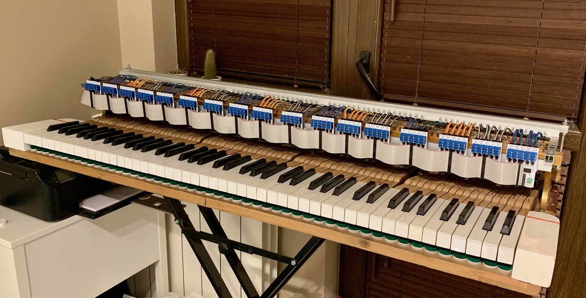
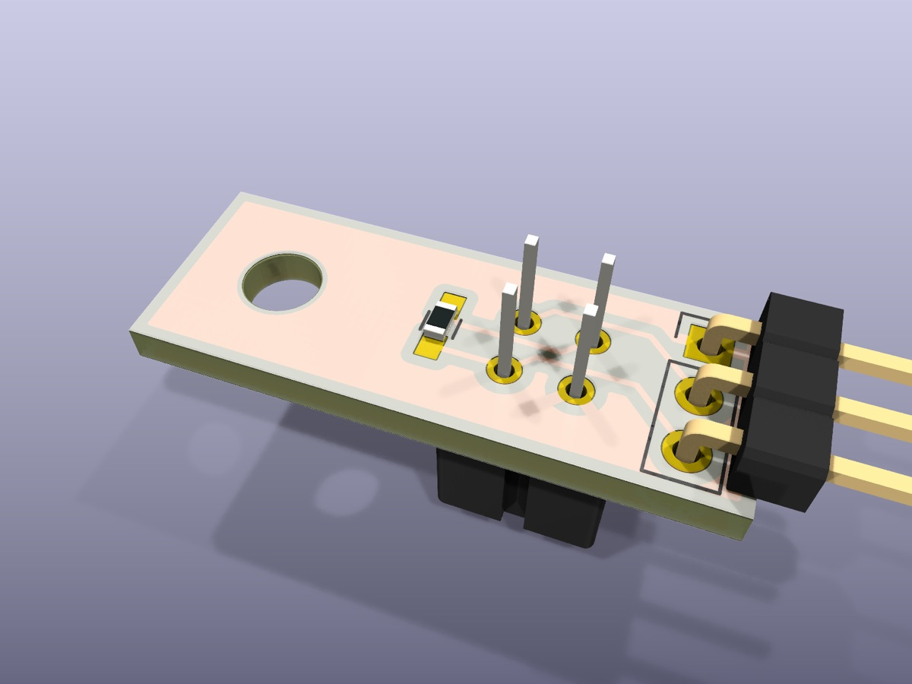
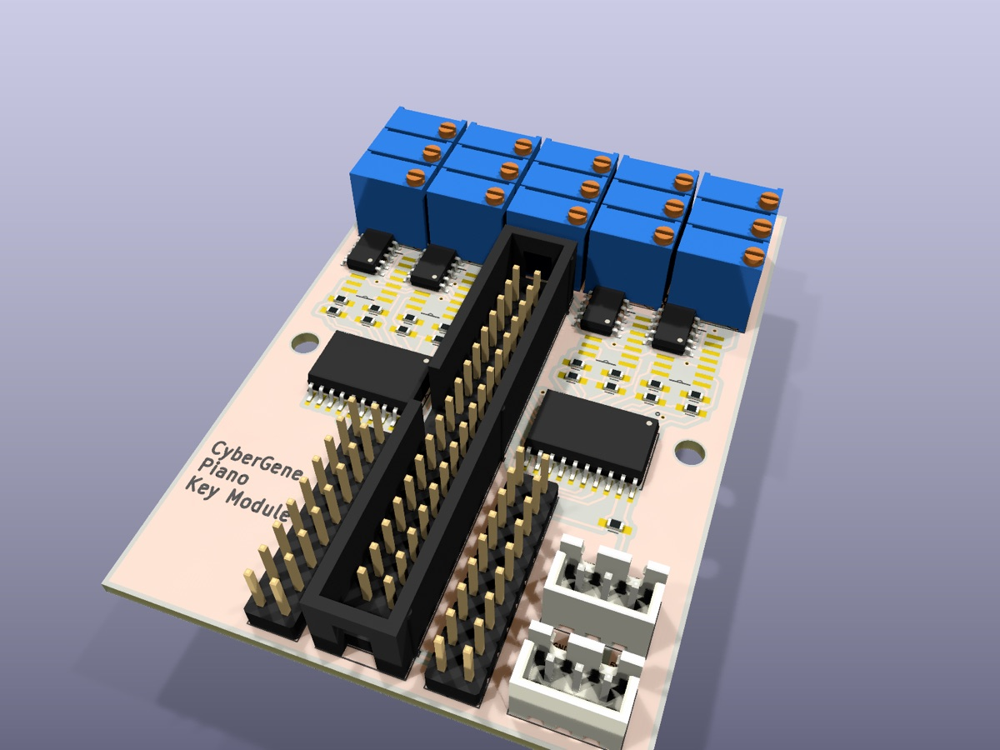
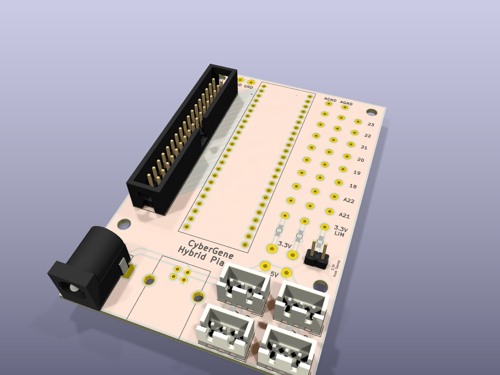

# Cybrid

**A DIY hybrid piano: a real grand piano action turned into a MIDI controller.**

[](https://github.com/ekumanov/cybrid/actions/workflows/firmware.yml)
[](https://github.com/ekumanov/cybrid/actions/workflows/hardware.yml)
[](LICENSE)



Instruments with a real wooden piano action and a digital sound engine are called *hybrid* pianos;
the Yamaha AvantGrand N1X I own is one. I wondered whether I could build something similar myself,
and in 2020 finished **Cybrid**: one optical sensor above each hammer of a grand piano action
measures the hammer's speed just before it hits the stop rail, and a Teensy turns that into MIDI.
The name was suggested on a piano forum: **Cyb**erGene (my nickname) + hy**brid**.

I'm a Java engineer and had no experience with electronics, PCB design, microcontrollers or piano
regulation when I started, so I learned it all along the way. V1 is the result: it works and I
play it daily, but many decisions are clumsy. This repository documents it as built, and is
structured so that better versions can follow.

▶ **Demo video:**

[](https://youtu.be/x7ZbjIRRwVg)

## How it works, in short

- A **CNY70** reflective optical sensor above each hammer shank gives a voltage that rises as the
  hammer approaches.
- Three **LM339** comparators per key turn it into three digital signals: the hammer is past the
  damper point, the escapement point, or the strike point. Trimpots set the three points.
- A **Teensy** scans all 88 keys in a few microseconds through a shared bus, times the flight from
  escapement to strike, and sends MIDI note-on with a velocity derived from it.

Full explanation: [How it works](docs/v1/how-it-works.md).

<table>
<tr>
<td align="center"><br><b>Sensor board</b> × 88</td>
<td align="center"><br><b>Note board</b> × 18 (5 keys each)</td>
<td align="center"><br><b>Teensy board</b> × 1</td>
</tr>
</table>

## Versions

| Version | Status | |
|---|---|---|
| **V1** | Built 2019–2020, played daily. Comparators + trimpots, Teensy 3.6/4.1, hand-made ribbon cable. | [hardware](hardware/v1) · [firmware](firmware/v1) · [docs](docs/v1) |

## Documentation

| | |
|---|---|
| [How it works](docs/v1/how-it-works.md) | Sensing principle, grouping and multiplexing, scanning algorithm, velocity |
| [Hardware](hardware/v1/README.md) | The three boards: schematics, 3D renders, bill of materials, manufacturing files |
| [Build guide](docs/v1/build-guide.md) | Soldering, mounting, wiring, power, the ribbon cable, known problems |
| [Firmware](firmware/v1/README.md) | Building and flashing (Arduino IDE or PlatformIO), configuration, tests |
| [Calibration](docs/v1/calibration.md) | Setting the three points of every key |
| [Photo gallery](docs/v1/gallery.md) | The V1 build in pictures |
| [Changelog](CHANGELOG.md) | |

## Repository layout

```
cybrid/
├── hardware/v1/      KiCad 10 projects for the three boards, export script for fab outputs
├── firmware/v1/      Teensy firmware (PlatformIO project), calibration sketches, host tests
├── docs/
│   ├── v1/           how it works, build guide, calibration, gallery
│   └── images/v1/    photos and board renders
├── LICENSES/         full license texts
└── .github/          CI: firmware build + tests, hardware export
```

Each future version gets its own `hardware/vN`, `firmware/vN` and `docs/vN`, so V1 stays buildable
as it is.

## Community

Discussion thread on the
[PianoClack forum](https://pianoclack.com/forum/d/107-cybrid-a-diy-midi-controller-with-grand-piano-action).
I'm glad Cybrid has inspired other projects, several of them better designed and easier to
reproduce. Questions, issues and pull requests are welcome.

## Credits

Using voltage comparators to turn the analog sensor signal into fast digital signals was
suggested by **Marcos Daniel** on the PianoWorld forums. Everything else (multiplexing, PCB design,
firmware and the integration with the grand piano action) is by Evgeni Kumanov (CyberGene).

## License

Open source hardware and software. Hardware is under
[CERN-OHL-P-2.0](LICENSES/CERN-OHL-P-2.0.txt), software under [MIT](LICENSES/MIT.txt), and
documentation and photos under [CC-BY-4.0](LICENSES/CC-BY-4.0.txt). See [LICENSE](LICENSE) for
details.
