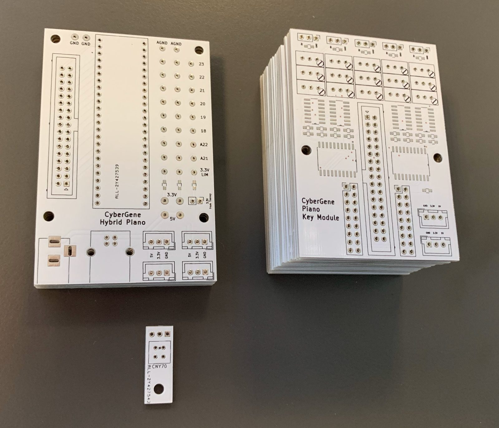
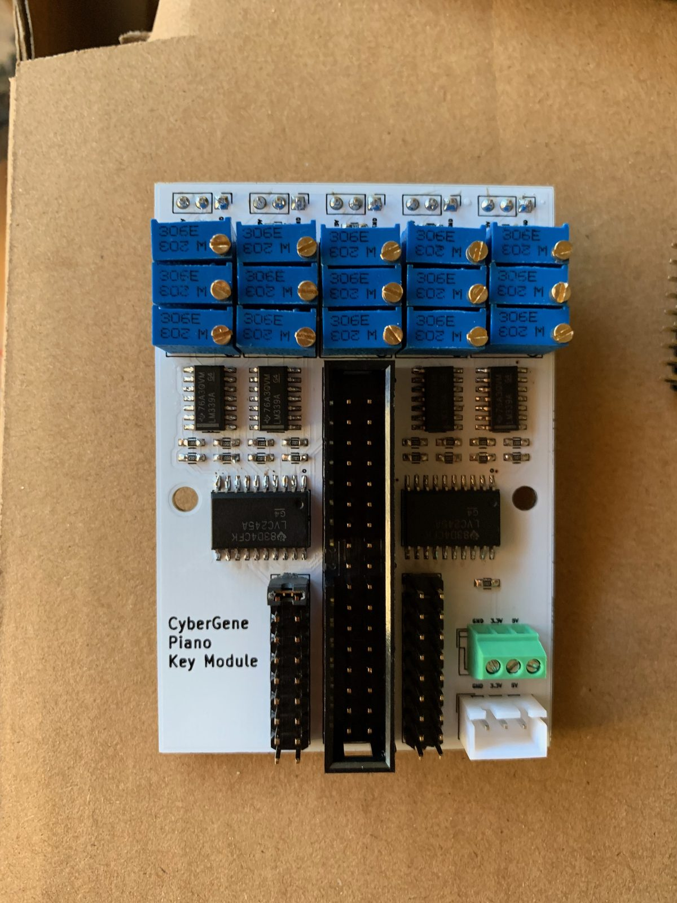
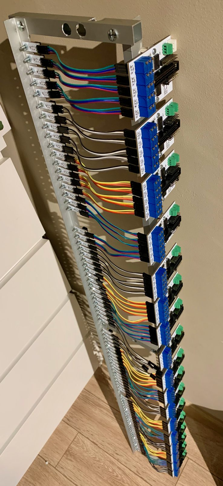
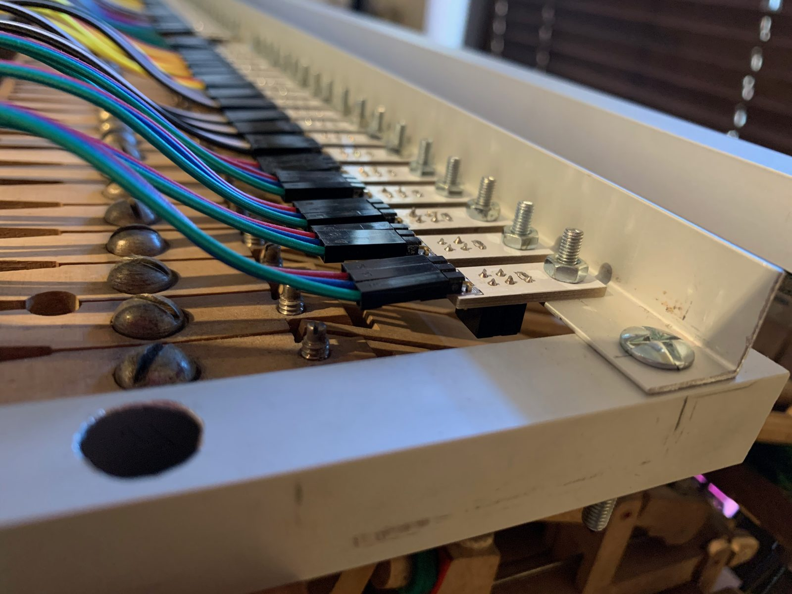
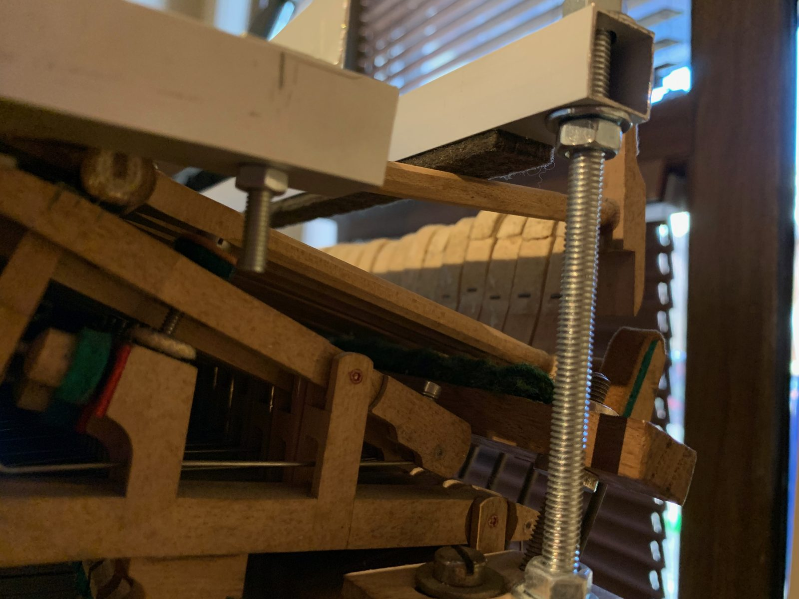
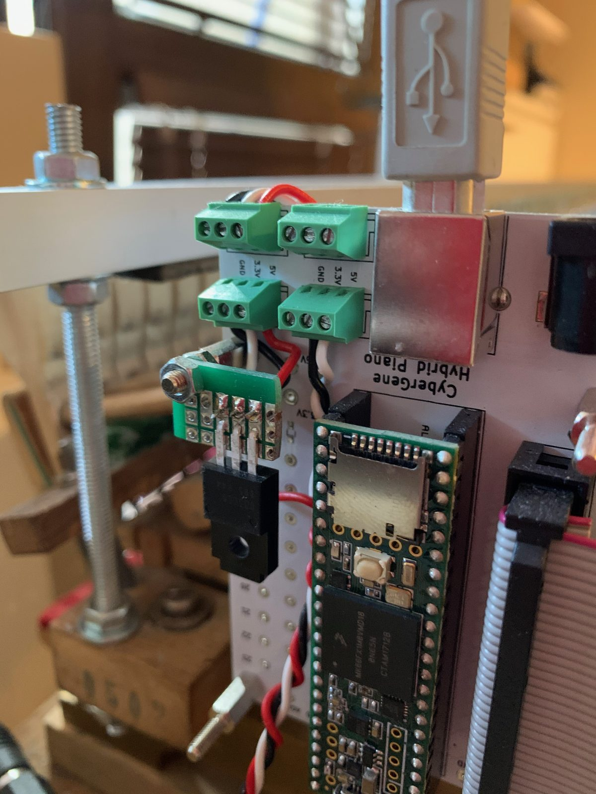
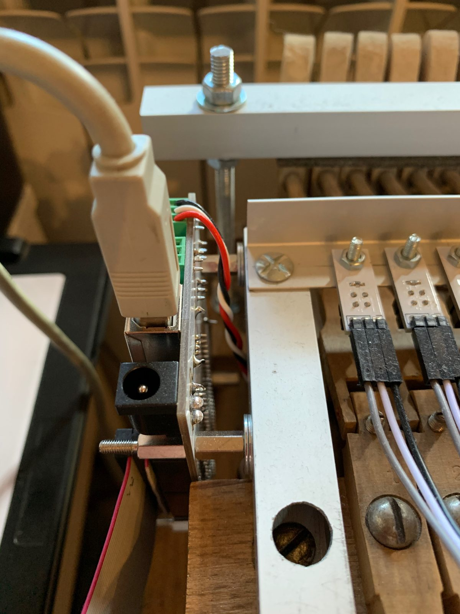
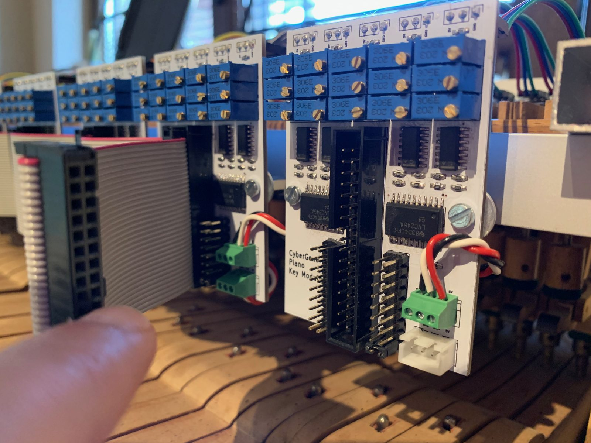
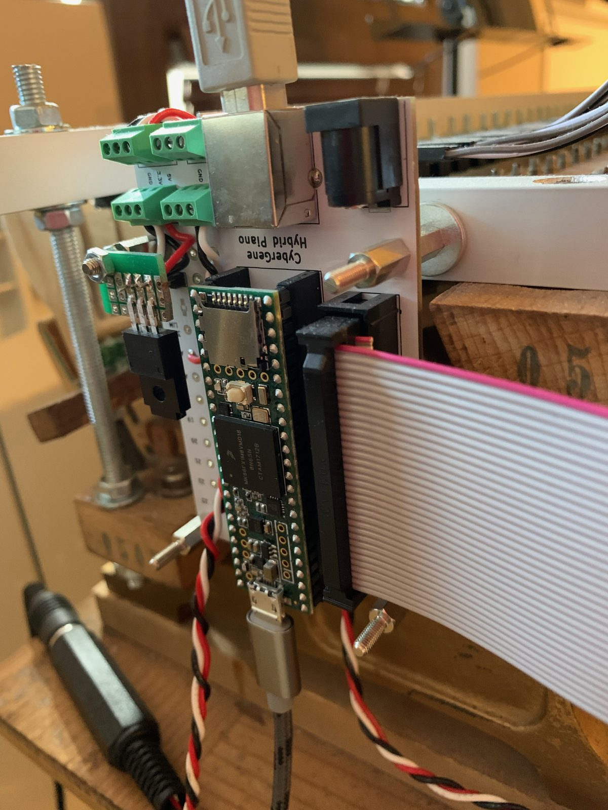

# Building Cybrid V1

This is what I learned building my instrument in 2019–2020, collected from the original README and
from answers to people who asked by e-mail. V1 is a one-off build, not a kit: expect to adapt the
mechanics to your own piano action.

Before you start, read [Known problems](#known-problems).

- [What you need](#what-you-need)
- [Soldering the boards](#soldering-the-boards)
- [Mounting and wiring](#mounting-and-wiring)
- [Power](#power)
- [The ribbon cable](#the-ribbon-cable)
- [Pedal](#pedal)
- [Firmware and calibration](#firmware-and-calibration)
- [Known problems](#known-problems)

## What you need

- A grand piano action with its keyframe, and a stand or frame to hold it
- **88 sensor boards, 18 note boards and 1 Teensy board**: order the PCBs from the Gerbers
  produced by [`hardware/v1/export.sh`](../../hardware/v1/README.md#manufacturing)
- The parts in the [bill of materials](../../hardware/v1/README.md#bill-of-materials)
- A Teensy 3.6 or 4.1 (4.1 recommended; 3.6 is discontinued)
- An aluminium profile (a rail) over the hammer shanks to hold the sensor boards, and a way to
  fix it to the action brackets (I used threaded rods)
- 10 cm female–female 3-wire Dupont cables (one per key), a 34-wire ribbon cable and 18 IDC-34
  connectors, solid-core wire for power
- A 5 V supply of at least 2 A (see [Power](#power))

## Soldering the boards

- All SMD parts are **0603**. According to my research at the time, that was the smallest size
  that can still be hand soldered. It's tiny; I used a head-mounted magnifier with changeable
  lenses.
- **Chips:** solder them so that the notch (pin-1 mark) matches the small circle printed on the PCB.
- **Note board, back side:** the six 100 nF capacitors go on the back, together with the five
  3-pin headers that the sensor cables plug into. Everything else is on the front.
- **Sensor board:** the CNY70 goes on the bottom (facing the hammer). Orient it so that the side of
  the cube with the printed text is next to the "CNY70" label on the board.
- **Teensy board:** the three resistor footprints (R1–R3) are left empty. They were meant to limit
  the current to pedals connected to the analog inputs, but my Kawai pedal works without them.

### Which trimpot belongs to which key

On each note board, the five sensor connectors are numbered **J1, J2, J5, J3, J4 from left to
right**. The trimpots follow the connector *numbers*, not their positions: RV1x serve J1, RV2x
serve J2, and so on, so **RV5x serve the third key** of the group. In each column of three, the
uppermost trimpot sets point 1 (the strike point, closest to the stop rail).

### Setting the group number

Each note board has a jumper on its 2×9 header pair that sets the group number the firmware reads
it as. On the left header, positions top to bottom are groups 1–9; on the right header, top to
bottom, groups 10–18. Group 1 is the lowest part of the keyboard.

## Mounting and wiring

- The sensor boards are screwed to an aluminium rail above the hammer shanks, close to the flanges,
  one per hammer. The note boards are mounted in a row along the same rail.
- Each sensor board connects to its note board with a short female–female 3-wire Dupont cable, so
  both ends have male pins: a straight 1×3 header on the back of the note board, and a right-angle
  1×3 header on the sensor board, with the pins pointing off the end of the board, parallel to it.
  I cut the 3-pin pieces from longer header strips (tedious). Before soldering these, check the mechanical placement on *your*
  action: whether you need straight or angled connectors, and on which side, depends on how the
  cables can run. I spent a lot of time on this; the photos show where I ended up.
- The action's brackets split the hammers into groups, so the sensors are not evenly spaced and
  some note boards sit behind five sensors with a bracket in between.

## Power

- 5 V comes in on the Teensy board (USB-B socket used for power only, or the barrel jack) and is
  daisy-chained to the note boards over two 3-pin JST-XH sockets per board, using solid-core
  breadboard wire.
- **Use a supply of at least 2 A.** By the schematic values each CNY70 LED draws about 16 mA, so 85–88
  sensors take about 1.4 A, around 7 W. (The old README said 2 W, which is too low.) I used an iPad
  charger.
- 3.3 V for the transceivers: the Teensy board has a jumper (JP1) to take 3.3 V from the Teensy, but
  I don't use it or recommend it. A fault on a note board could damage the Teensy. Instead I added a
  small 3.3 V regulator on a piece of perfboard, fed from the 5 V line (see the photo). The current
  on 3.3 V is small, so almost any regulator will do.
- Stable, low-ripple power matters: see [Known problems](#known-problems).

## The ribbon cable

All note boards and the Teensy board share one IDC-34 ribbon cable with 19 connectors.

- **Make it last.** Mount the note boards first: their spacing follows the action brackets, so it
  isn't uniform, and you can only place the connectors once the boards are fixed.
- Crimping 19 connectors in a straight line is hard; I wasted one cable trying. I built a small
  clamping jig (see the photos) and made the cable intentionally wavy.
- The IDC socket on the Teensy board is rotated relative to the note boards (a design mistake), so
  to connect the cable without a twist the Teensy board has to be mounted **upside down**.

## Pedal

The Teensy board powers the sustain pedal and reads it on an analog input: A21 on a Teensy 3.6, A16
(pin 40) on a Teensy 4.1. The firmware has calibration limits for my Kawai half-pedal; adjust them
for yours (see the firmware).

## Firmware and calibration

1. Build and flash the firmware: see [firmware/v1](../../firmware/v1/README.md).
2. Set the three points of every key: see [Calibration](calibration.md).

## Known problems

- **Power and ripple.** Power is chained over wires and JST connectors through all the note boards,
  with only 100 nF decoupling and no bulk capacitance. A cleaner power distribution is needed.
- **One cable, single point of failure.** In my instrument, a line shorted to group 7 permanently
  disables group 16. The firmware works around it with `FAULTY_LINE 16`, which is still the default
  setting. Set `FAULTY_LINE 0` and `PIANO_SIZE` to your number of keys (mine has 85).
- **Power sequencing.** The Teensy is powered from the computer and the boards from the charger. With
  the charger on and the computer off, the boards can back-feed the Teensy through its pins. Power
  both together.
- **255–264 trimpots.** Calibration is manual and analog thresholds drift. This is the biggest
  limitation of V1.

## More photos

See the [photo gallery](gallery.md).
