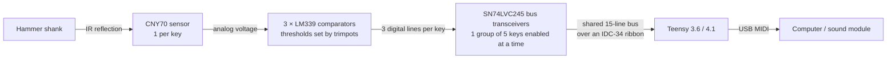

# How Cybrid V1 works

Cybrid measures the velocity of each **hammer** of a real grand piano action, just before it hits the
stop rail, and turns it into a MIDI note-on velocity. It senses the hammers, not the keys, so it
"listens" to the same motion an acoustic piano's strings respond to.

## Sensing: from distance to three digital points

The [Vishay CNY70](https://datasheet.octopart.com/CNY70-Vishay-datasheet-5434663.pdf) is a reflective optical sensor: an
infrared LED and a phototransistor in one package. One CNY70 sits above each hammer shank. The closer
the shank, the more light is reflected and the higher the voltage across the phototransistor's load
resistor.

Instead of digitising that voltage with an ADC, Cybrid feeds it to
[LM339](https://www.ti.com/lit/ds/symlink/lm2901.pdf) voltage comparators. A comparator has two inputs
and a digital output: the sensor voltage on one input, a reference voltage from a trimpot on the
other. The output switches in a few nanoseconds when the hammer crosses the distance that the
reference voltage corresponds to. Each key has three comparators, so three trimpots define three
distance points:

| Point | Where | Used for |
|---|---|---|
| **Point 3** | about halfway between the rest position and the stop rail | damper: the note sounds while the hammer is above it; dropping below it sends note-off |
| **Point 2** | about 1 mm before the stop rail (where escapement happens) | starts the flight-time measurement |
| **Point 1** | at (or very close to) the stop rail | stops the measurement: this is the strike, note-on is sent |

The comparator outputs are **active low** and nested: when the hammer is at point 1 it is also past
points 2 and 3, so all three lines are low.

Velocity comes from the time the hammer takes between point 2 and point 1. A faster hammer means a
shorter time and a louder note.

> The idea of using voltage comparators to turn the continuous sensor signal into fast digital
> signals was suggested by Marcos Daniel on the PianoWorld forums. The multiplexing, PCB design,
> firmware and integration with the grand piano action are mine.

### Why not just use ADCs?

When this was designed in 2020, scanning 88 keys with analog-to-digital conversion was impractical:
microcontrollers have one or two ADCs, a conversion takes microseconds, and multiplexing 88 analog
signals adds noise and settling time. The whole keyboard would have to be scanned in a few
microseconds to time a fortissimo hammer accurately. Comparators move the "is the hammer past this
point?" decision into hardware, so the microcontroller only has to read digital pins, which takes
nanoseconds.

## Reading 264 signal lines with 33 pins: grouping

88 keys × 3 points = 264 digital signals, far more than the 58 I/O pins of a
[Teensy](https://www.pjrc.com/teensy/). Cybrid groups keys **5 at a time**:

- **18 groups × 5 keys** = 90 positions (the last group uses only 3), 88 keys
- **5 keys × 3 points** = 15 signal lines per group
- The 15 lines are shared by all groups. The Teensy enables one group at a time with 18 enable lines.

**18 enable outputs + 15 shared inputs = 33 Teensy pins.**

Wiring all groups' outputs together directly would short them: one group's comparator can pull a
line low while another's pulls it high. Each group therefore drives the shared bus through
[SN74LVC245A](https://www.ti.com/lit/ds/symlink/sn74lvc245a.pdf) octal bus transceivers with
3-state outputs. A disabled transceiver puts its outputs in high impedance, so only the enabled
group drives the bus. Using enables instead of multiplexer chips avoids a mux's switching delay;
the scan loop's speed matters more than anything else.

## The three boards

| Board | Qty (88 keys) | What it does |
|---|---|---|
| **Sensor board** | 88 | One CNY70 and its LED resistor, mounted above a hammer shank. 3-wire connection (5 V, signal, GND) to a note board. |
| **Note board** (group module) | 18 | Serves 5 sensor boards: 15 trimpots, 4 LM339 comparators, 2 SN74LVC245 transceivers. A jumper on the 2×9 header (SEL1/SEL2) sets the board's group number (1–18). An IDC-34 socket connects it to the shared ribbon cable, and two 3-pin power sockets (5 V, 3.3 V, GND) daisy-chain power to the next board. |
| **Teensy board** | 1 | Carries the Teensy, the IDC-34 socket for the ribbon cable, power inputs (USB-B, barrel jack) and power outputs to the note boards, plus pads for analog inputs such as a half-pedal. |

The comparators and CNY70s run from 5 V, while the transceivers run from 3.3 V because the Teensy's
inputs are 3.3 V only (Teensy 3.6 and 4.1 are not 5 V tolerant). The Teensy itself is powered from
the computer over its own USB port, which also carries MIDI.

See the [hardware docs](../../hardware/v1/README.md) for schematics, renders and the BOM, and the
[build guide](build-guide.md) for assembly.

## Scanning algorithm

The firmware loop enables each group in turn and reads its 15 inputs. Each key runs a small state
machine:

1. **Point 2 reached** for the first time: remember the timestamp (the hammer has escaped).
2. **Point 1 reached** for the first time: a strike. The flight time since point 2 is converted to a
   MIDI velocity and a note-on is sent.
3. While the key is held, the hammer stays above **point 3** and the note sustains. Repetition with
   the key held works the way it does on a grand: the hammer can re-arm and strike again.
4. When the hammer drops below **point 3**, note-off is sent.

Events are only seen when the scan reaches their group, so a strike is detected on the scan after it
happens. The faster the full scan, the more precise the timing. V1.2 measured about 8.9 µs for a
full-keyboard scan; V1.3 is estimated at about 3–5 µs on a Teensy 4.1 (see
[firmware](../../firmware/v1/README.md)).

### Velocity curve and per-group grading

Velocity is roughly linear in the logarithm of the flight time. To avoid computing logarithms
during the scan, the firmware precomputes a table that maps flight time to MIDI velocity at
startup. High-register hammers are lighter than bass hammers and reach the rail faster for the
same playing effort, so the table is graded per group (per note board) to keep the instrument even.

### Half-pedal

A continuous sustain pedal (a Kawai half-pedal in the author's instrument) is read with the
Teensy's ADC and sent as MIDI CC 64. It is on pin A21 on a Teensy 3.6 and A16 (pin 40) on a
Teensy 4.1.
