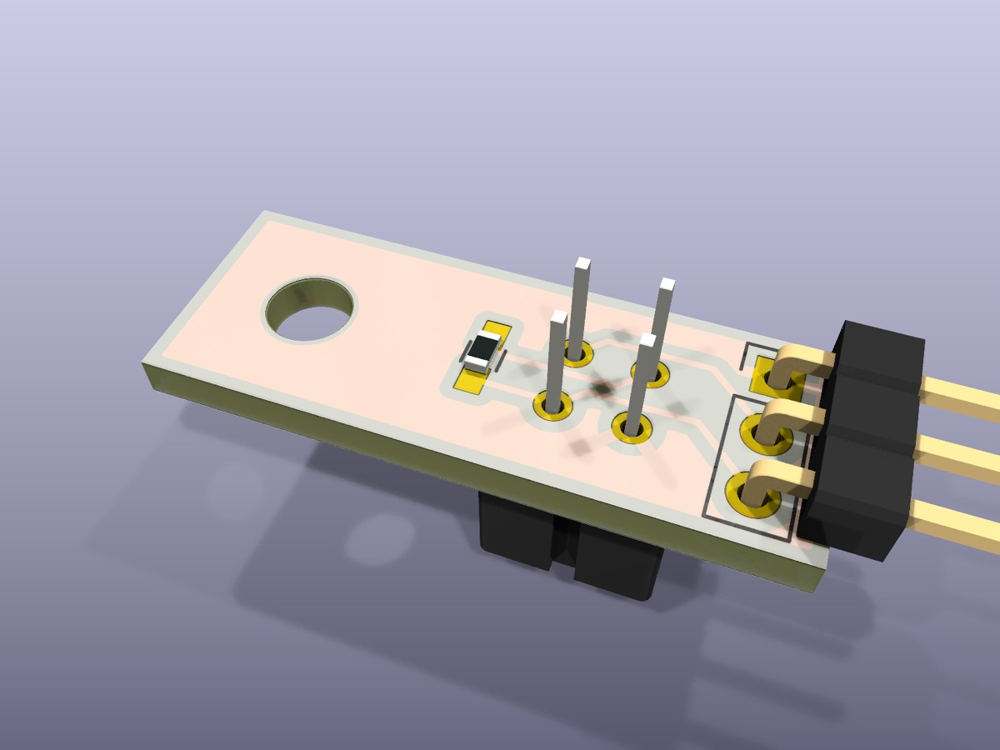
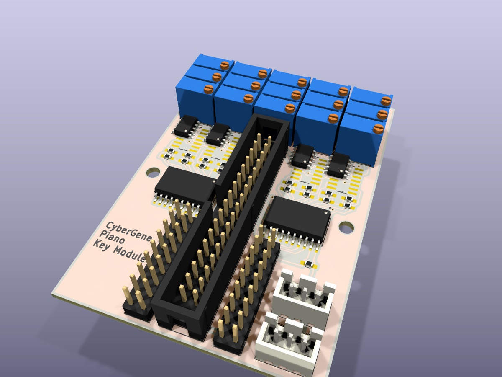
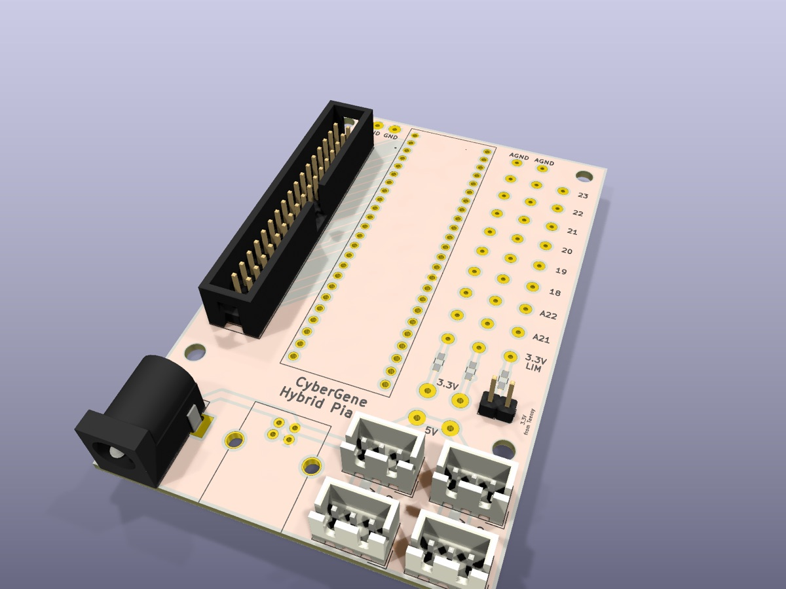
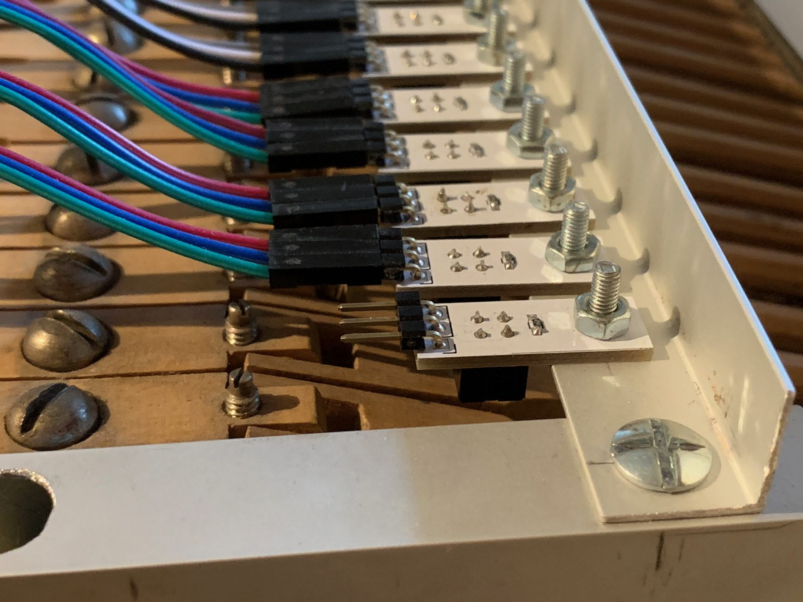
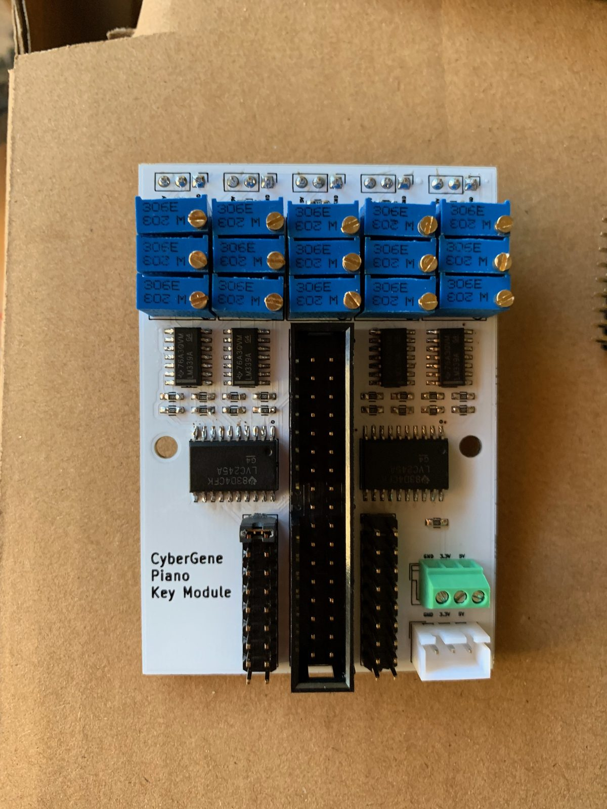
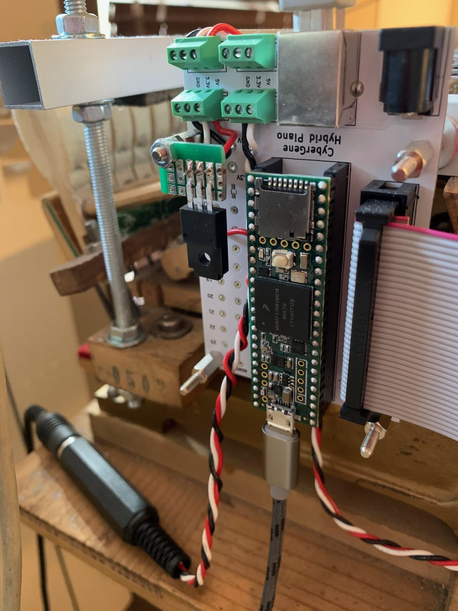

# Cybrid V1 hardware

KiCad sources for the three V1 boards, as fabricated and built in 2019–2020. How they work together is
explained in [How it works](../../docs/v1/how-it-works.md); assembly is in the
[build guide](../../docs/v1/build-guide.md).

| | Sensor board | Note board | Teensy board |
|---|---|---|---|
| 3D render |  |  |  |
| As built |  |  |  |
| Role | 1 CNY70 above one hammer shank | 5 keys: comparators, trimpots, bus transceivers | Teensy, ribbon-cable socket, power distribution |
| Qty for 88 keys | 88 | 18 | 1 |
| Size | 24.1 × 8.9 mm | 53.3 × 76.2 mm | 57.1 × 87.6 mm |
| Layers | 2 | 2 | 2 |
| Schematic | [PDF](sensor-board/sensor-board-schematic.pdf) | [PDF](note-board/note-board-schematic.pdf) | [PDF](teensy-board/teensy-board-schematic.pdf) |
| KiCad project | [`sensor-board/`](sensor-board) | [`note-board/`](note-board) | [`teensy-board/`](teensy-board) |

Top and bottom renders of every board are in [`docs/images/v1/boards`](../../docs/images/v1/boards).
The 3D renders show no Teensy and no USB-B socket, because KiCad's library has no 3D models for them.

## Opening the designs

Install [KiCad](https://www.kicad.org/download/) **10 or newer** and open a board's `.kicad_pro`
file. No extra libraries are needed: the schematic symbols and footprints are embedded in the
design files, and the 3D models come from KiCad's standard library.

```
hardware/v1/
├── export.sh                 regenerates all outputs (see below)
├── tools/                    one-off scripts used to modernise the 2020 files (kept for reference)
├── sensor-board/
│   ├── sensor-board.kicad_pro    project
│   ├── sensor-board.kicad_sch    schematic
│   ├── sensor-board.kicad_pcb    board
│   └── sensor-board-schematic.pdf
├── note-board/   (same layout)
└── teensy-board/ (same layout)
```

## Manufacturing

Generate the fabrication files with:

```bash
hardware/v1/export.sh
```

This writes `hardware/v1/build/<board>/` (not committed): Gerbers and Excellon drill files in
`fab/` and zipped as `<board>-fab.zip` (upload that to any PCB fab), the schematic PDF, the BOM as
CSV, 3D renders, and ERC/DRC reports. `DOCS=1 hardware/v1/export.sh` also refreshes the schematic
PDFs and renders committed for the docs. GitHub Actions runs the same export on every change to
`hardware/` and keeps the outputs as a downloadable artifact.

My boards were made as standard 2-layer, 1.6 mm FR-4 boards with **white solder mask and black
silkscreen**. All SMD parts are 0603 or SOIC, hand-solderable.

## Bill of materials

Per board, from the schematics (`<board>-bom.csv` from the export has the reference designators).
The links are where I bought parts in 2020 (a Bulgarian distributor); any equivalent part works.

### Note board (× 18 for 88 keys)

| Qty | Part | Value / type | Package | Refs |
|---|---|---|---|---|
| 4 | Quad voltage comparator | LM339AD (TI) | SOIC-14 | CMP1–CMP4 |
| 2 | Octal bus transceiver, 3-state | SN74LVC245ADWR (TI) | SOIC-20 wide (7.5 mm) | TX1, TX2 |
| 15 | Trimpot, multi-turn, top adjust | 10 kΩ (20 kΩ also works), Bourns 3296W | THT | RV11–RV53 |
| 17 | Resistor | 10 kΩ | 0603 | R1, R11–R44 |
| 5 | Resistor (sensor load) | 4.7 kΩ | 0603 | R18, R28, R38, R48, R58 |
| 6 | Capacitor, ceramic (back side) | 100 nF | 0603 | C1–C6 |
| 1 | Box header, straight | 2×17, 2.54 mm (IDC-34) | THT | COMM1 |
| 2 | Pin header + 1 jumper | 2×9, 2.54 mm | THT | SEL1, SEL2 |
| 5 | Pin header (back side, sensor cables) | 1×3, 2.54 mm | THT | J1–J5 |
| 2 | Wire-to-board header, power in/out | JST XH 3-pin (B3B-XH-A) | THT | PWR1, PWR2 |

### Sensor board (× 88)

| Qty | Part | Value / type | Package | Refs |
|---|---|---|---|---|
| 1 | Reflective optical sensor | Vishay CNY70 | THT | S1 |
| 1 | Resistor (LED current, ~16 mA) | 240 Ω | 0603 | R1 |
| 1 | Pin header, right angle, male (cut from a longer strip) | 1×3, 2.54 mm | THT | J1 |

### Teensy board (× 1)

| Qty | Part | Value / type | Package | Refs |
|---|---|---|---|---|
| 1 | Microcontroller | Teensy 4.1 (or 3.6), with pin headers | module | CTL1 |
| 1 | Box header, straight | 2×17, 2.54 mm (IDC-34) | THT | COMM1 |
| 4 | Wire-to-board header, power out | JST XH 3-pin (B3B-XH-A) | THT | PWR1–PWR4 |
| 1 | USB-B socket (power input only) | | THT | USB1 |
| 1 | DC barrel jack (alternative power input) | | THT | J11 |
| 1 | Pin header + jumper (3.3 V from Teensy, not recommended) | 1×2, 2.54 mm | THT | JP1 |
| 3 | Resistor, pedal current limit | **not fitted** | 0603 | R1–R3 |
| 1 | 3.3 V linear regulator, on a small perfboard (not on the PCB) | any, low current | | |

### Cabling and mechanics

| Qty (88 keys) | Part |
|---|---|
| 88 | 3-wire female–female Dupont cable, 10 cm (sensor to note board) |
| 19 | IDC-34 ribbon connector (18 note boards + Teensy board) |
| ~1.5 m | 34-wire ribbon cable, 1.27 mm pitch |
| 2 per board | JST XH 3-pin housings + crimp contacts, and solid-core wire for the power chain |
| 1 | 5 V power supply, ≥ 2 A (USB charger) |
| 1 | Aluminium profile for the sensor rail, threaded rods and nuts to fix it to the action |

### Totals for 88 keys

| Part | Qty |
|---|---|
| CNY70 | 88 |
| LM339AD | 72 |
| SN74LVC245ADWR | 36 |
| Trimpot 10 kΩ, Bourns 3296W | 270 (264 used) |
| Resistor 0603: 10 kΩ / 4.7 kΩ / 240 Ω | 306 / 90 / 88 |
| Capacitor 0603 100 nF | 108 |

## What changed in 2026

The boards were drawn in KiCad 5.0 in 2019–2020. In 2026 the projects were migrated to KiCad 10
without changing the design:

- Converted to the KiCad 10 file format; files renamed (`My Piano Controller Note Module 3 (5-note,
  5V pots)` became `note-board`). The old rescue/cache libraries are no longer needed because KiCad
  now embeds symbols in the schematic.
- **Connectivity verified unchanged:** for every board, each net in the schematic connects exactly
  the same pads as on the board (49, 73 and 4 nets), and DRC reports no unconnected items.
- Component values written into the schematics (they were generic `R`, `C`, `R_POT_TRIM` and
  existed only in e-mails). The unfitted R1–R3 on the Teensy board are marked *do not populate*.
- 3D models assigned from KiCad's library (most footprints had none), and the board stackup records
  the real colours (white mask, black silk), so 3D views look like the real boards.
  ([`tools/`](tools) has the scripts used.)
- Copper zones refilled with KiCad 10's filler; pours may differ slightly from the 2020 Gerbers.
- Generated files (Gerbers, drill files, netlists, `.bak` files, the Freerouting `.dsn`/`.ses`
  files) were removed from the repository. The 2020 versions remain in the git history.

### Known warnings

ERC and DRC report warnings that predate the migration or are cosmetic:

- *Net name mismatches between schematic and board* (`+3V3` vs `+3.3V`, auto-generated net names):
  KiCad 10 names nets differently from KiCad 5; the connections are identical (see above).
  Don't run **Update PCB from Schematic** without reviewing the changes: it would also try to swap
  the custom Teensy footprint.
- *Library links*: the footprints and symbols came from KiCad 5 libraries and custom downloads
  that no longer exist under those names. The embedded copies are complete.
- Silkscreen text size, overlapping courtyards and silk-to-edge clearances: fabricated and working
  as is.

### About the autorouting

The note and Teensy boards were routed with [Freerouting](https://github.com/freerouting/freerouting), the
open-source Java autorouter (exported from KiCad as `.dsn`, routed, imported back as `.ses`). The
result lives in the `.kicad_pcb` now, so neither the tool nor the intermediate files are needed to
open, change or manufacture the boards. For a future version, Freerouting is available as a KiCad
plugin from the Plugin and Content Manager. For dense or timing-sensitive boards, hand-routing
the critical nets is still the better choice.
